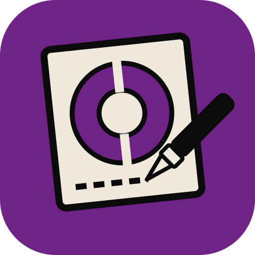
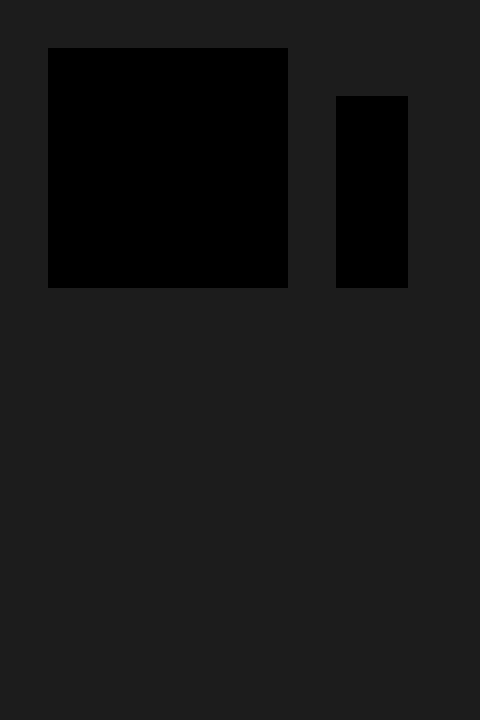
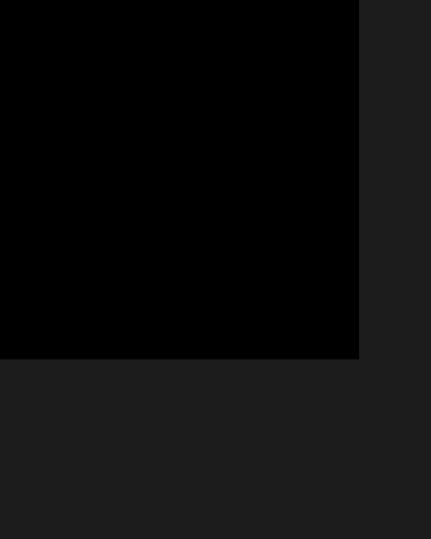

<p align="center">
  
</p>

<h1 align="center">StencilCraft</h1>

<p align="center">
  <b>Cut preparation; an open-source, modern stencil and cutting-prep application, built in pure Rust.</b>
</p>

<p align="center">
  A fast, open-source stencil workflow. It runs natively on macOS, Windows and Linux, and in the
  browser via WebAssembly (planned). Following the direction of
  [VectorCraft](https://github.com/storytold/vectorcraft) and the Crafting Apps: one codebase,
  written from scratch.
</p>

<p align="center">
  
  
  
  
  
</p>

<p align="center">
  <a href="#a-look-around">A look around</a> ·
  <a href="#why-stencilcraft">Why StencilCraft</a> ·
  <a href="#quick-start">Quick start</a> ·
  <a href="#use-it-from-claude-code-and-other-agents">Agents</a> ·
  <a href="#status">Status</a> ·
  <a href="#downloads">Downloads</a> ·
  <a href="#the-crafting-direction">The Crafting direction</a> ·
  <a href="#license-and-credits">License</a>
</p>

## A look around

Every image below is rendered by StencilCraft's own SVG exporter from the
[`examples/`](examples) documents it refers to.

<table>
<tr>
<td width="33%" valign="top">
  
  <p align="center"><sub><b>Starter</b>: two cut shapes and an engraving line on the default board · <code>examples/starter.stencilcraft</code></sub></p>
</td>
<td width="33%" valign="top">
  
  <p align="center"><sub><b>Kerf compensation</b>: the outer frame widens while the counter shrinks · <code>examples/stencil-frame.stencilcraft</code></sub></p>
</td>
<td width="33%" valign="top">
  
  <p align="center"><sub><b>Tiling</b>: a 500 × 400 mm board split onto printable sheets · <code>examples/poster.stencilcraft</code></sub></p>
</td>
</tr>
</table>

> [!NOTE]
> `stencilcraft-cli cut` without `--device` is a **dry run**: it prints the exact
> Graphtec command transcript and never touches hardware. A real send is a
> deliberate, explicit step — and every model, media preset and cutting mat is
> chosen in the Send panel the same way.

## Why StencilCraft

- **Familiar.** Laser/vinyl workflow conventions from public user documentation only,
  clean-room: never reading or copying another cutting-prep program's code or assets.
  Graphtec protocol facts come from community-reverse-engineered GPL drivers as
  *specifications only* ([inkscape-silhouette](https://github.com/fablabnbg/inkscape-silhouette),
  [inkscape-cutcutgo](https://github.com/virtualabs/inkscape-cutcutgo),
  [pklaus/Silhouette-Cutting-Plotters](https://github.com/pklaus/Silhouette-Cutting-Plotters)) —
  no GPL code in this MIT/Apache codebase.
- **Robust.** No panics in shipped code: an untrusted file can never lose unsaved work.
  Fallible operations return `Result`; errors become calm messages, never aborts. The
  document reader is corpus-tested against thousands of malformed inputs.
- **Documented format.** The native document is plain JSON with the extension
  `.stencilcraft`; the header names `"format": "stencilcraft"` with a version, so files
  read years later.
- **Agent-native.** The CLI doubles as a JSON-lines control channel and MCP server, so
  agents can load, kerf-apply, tile, export and *dry-run cut* files the way a person does.
- **Craft-libs.** Reusable domain crates, the VectorCraft way: `geom`, `color`, `doc`,
  `kerf`, `tiling` … `machine` are each a layer any future Crafting App could borrow,
  and nothing below `ui-egui` knows about egui (enforced by `cargo xtask layers`).

## Quick start

```sh
git clone https://github.com/dylanmtaylor/stencilcraft
cd stencilcraft
cargo run --release -p stencilcraft                      # desktop app (Design / Send)
cargo run --release -p stencilcraft-cli -- run --in examples/starter.stencilcraft --export out.svg
cargo run --release -p stencilcraft-cli -- run --in examples/stencil-frame.stencilcraft --export out.svg   # kerf applied (0.2 mm)
cargo run --release -p stencilcraft-cli -- run --in examples/poster.stencilcraft \
                                        --tile-sheet 400x600 --overlap 10 --export out     # tiling
cargo run --release -p stencilcraft-cli -- cut --in examples/starter.stencilcraft          # machine dry-run transcript
cargo run --release -p stencilcraft-cli -- cut --in examples/starter.stencilcraft --device /dev/ttyUSB0  # real cut
cargo xtask ci                                            # fmt, clippy, tests, layering
```

Use the desktop app with a control channel in a second terminal:

```sh
cargo run -p stencilcraft -- --control 7979
```

`examples/` ships starter documents: `starter.stencilcraft` (the CLI round trip),
`stencil-frame.stencilcraft` (a true counter for kerf) and `poster.stencilcraft`
(an oversized board for tiling). Protocol and design notes live in [`docs/`](docs):
`machine.md` (the Graphtec command stream), `ui-design.md` (Silhouette/Cricut structure
on our skin), `architecture.md`, `mcp.md`, `gaps.md`, `development.md`.

## Use it from Claude Code and other agents

Register the MCP server with Claude Code:

```sh
claude mcp add stencilcraft -- /path/to/stencilcraft-cli mcp
```

The full method list and the equivalent MCP tools are in [`docs/mcp.md`](docs/mcp.md).

## Status

StencilCraft is under active development. [**ROADMAP.md**](ROADMAP.md) has the stage,
the numbers by dimension and what's next; [`docs/gaps.md`](docs/gaps.md) the ranked
list of what's missing.

**Where we are (2026-10-29): scaffold+.** The document model and `.stencilcraft` round
trip, kerf compensation, sheet tiling, and SVG/DXF/G-code exports work and are tested
(110 workspace tests); the desktop shell edits rectangle shapes, previews kerf,
saves/opens files and shows the **Design/Send** split with a live machine dry-run;
`cut` encodes Silhouette/Graphtec Cameo streams end to end (the protocol is in place;
real-hardware transport is the next step).

**What's missing:**
- SVG import beyond bare `<path>` data (groups, transforms, `style` attributes, the
  basic shapes, unit inference, `viewBox` scaling);
- drawing tools (pen, selection, node editing) — StencilCraft starts behind a vector app;
- tiling edge clipping, bridge generation so counters stay attached, registration marks;
- machine transports beyond serial documented dry-run + opt-in serial (USB bulk, Bluetooth).

**Where we're going:** next is real-world SVG import (transforms, groups, styles), then
the kerf offset hardening pass, then bridges and machine transports. The ranked list is
in [`docs/gaps.md`](docs/gaps.md).

**Workspace:** `crates/{geom, color, doc, kerf, tiling, svg, dxf, gcode, engine, machine, mcp, ui-egui, testkit}`
and `apps/{stencilcraft, stencilcraft-cli}`. The egui frontend is its own crate, so the
UI can be swapped without touching the engine.

## Downloads

There are no packaged releases yet — StencilCraft builds from source with
`cargo run --release -p stencilcraft` (desktop) or `cargo build --release -p stencilcraft-cli`
(headless). Release packaging, signed installers and the web build follow the Crafting
Apps release pattern and are on the roadmap (M5).

## The Crafting direction

StencilCraft follows the design decisions of
[VectorCraft](https://github.com/storytold/vectorcraft) and the Crafting Apps community.
It stands on its own: pure Rust, no dependency on Adobe software or code, dual-licensed
MIT OR Apache-2.0.

Agent and contributor rules (clean-room, the asset policy, no panics in shipped code,
quality gates) are in [`AGENTS.md`](AGENTS.md). Every bundled asset is listed with its
author, source and licence in [`ASSETS.md`](ASSETS.md).

## License and credits

StencilCraft is dual-licensed under MIT or Apache-2.0, at your option.
Copyright (c) 2026 StencilCraft contributors. Required notices are in [NOTICE](NOTICE).
