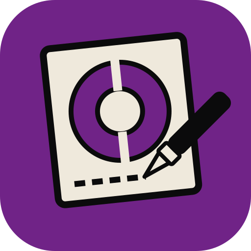
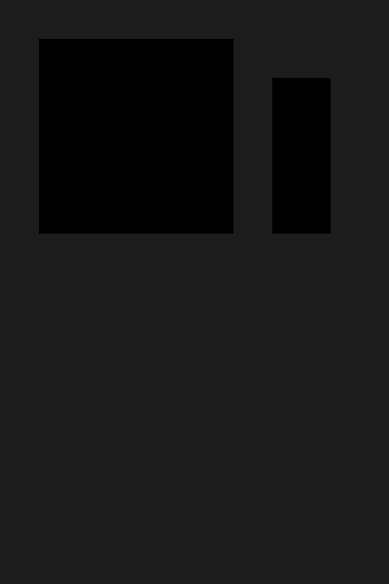
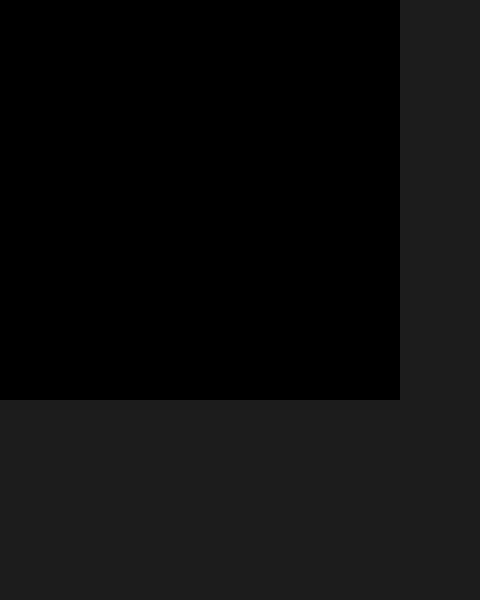
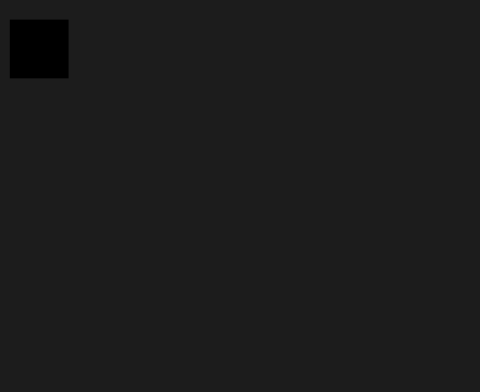

<p align="center">
  
</p>

<h1 align="center">StencilCraft</h1>

<p align="center">
  <b>Cut preparation; an open-source, modern stencil and cutting-prep application, built in pure Rust.</b>
</p>

<p align="center">
  A fast, open-source stencil workflow for laser, vinyl and blade cutters. It runs natively on
  macOS, Windows and Linux, and in the browser via WebAssembly (planned). It is one Rust
  codebase, written from scratch.
</p>

<p align="center">
  
  
  
  
  
  <br>
  <a href="https://github.com/dylanmtaylor/stencilcraft/actions/workflows/ci.yml"></a>
  <a href="https://sonarcloud.io/project/overview?id=storytold_stencilcraft"></a>
</p>

<br>

<p align="center">
  
  <br><sub><b>Starter</b>: cut and engrave layers on the board, one shape selected with its properties in the inspector · <code>examples/starter.stencilcraft</code></sub>
</p>

> [!NOTE]
> `stencilcraft-cli cut` without `--device` is a **dry run**: it prints the exact
> Graphtec command transcript and never touches hardware. A real send is a
> deliberate, explicit step — and every model, media preset and cutting mat is
> chosen in the Send panel the same way.

<p align="center">
  <a href="#a-look-around">A look around</a> ·
  <a href="#made-in-stencilcraft">Made in StencilCraft</a> ·
  <a href="#why-stencilcraft">Why StencilCraft</a> ·
  <a href="#quick-start">Quick start</a> ·
  <a href="#status">Status</a> ·
  <a href="#downloads">Downloads</a> ·
  <a href="#license-and-credits">License</a>
</p>

## A look around

LOOK_AROUND

## Made in StencilCraft

Every image below is rendered by StencilCraft's own SVG exporter (`stencilcraft-cli run` and
`tile-preview`) from the [`examples/`](examples) documents it names.

<table>
<tr>
<td width="33%" valign="top">
  
  <p align="center"><sub><b>Starter</b>: two cut shapes and an engraving line on the default board · <code>examples/starter.stencilcraft</code></sub></p>
</td>
<td width="33%" valign="top">
  
  <p align="center"><sub><b>Kerf compensation</b>: the outer frame widens while the counter shrinks · <code>examples/stencil-frame.stencilcraft</code></sub></p>
</td>
<td width="33%" valign="top">
  
  <p align="center"><sub><b>Tiling</b>: a 500 × 400 mm board split onto 300 × 300 mm sheets with a 10 mm overlap and registration marks · <code>examples/poster.stencilcraft</code></sub></p>
</td>
</tr>
</table>

## Why StencilCraft

- **Familiar.** Laser/vinyl workflow conventions learned clean-room. We drive the
  reference apps (Silhouette Studio, Cricut Design Space) through their normal UI on
  licensed installs and read their public documentation. We then write our own
  implementation. We never use their source code, never disassemble or decompile their
  binaries, never copy their assets, UI text or branding, and never bypass their
  licensing or sign-in. The observations and the feature inventory are in
  [`docs/reference-apps.md`](docs/reference-apps.md); the Silhouette-familiar menu bar is
  mapped in [`docs/menu-map.md`](docs/menu-map.md). Graphtec protocol facts come from
  community-reverse-engineered GPL drivers as *specifications only*
  ([inkscape-silhouette](https://github.com/fablabnbg/inkscape-silhouette),
  [inkscape-cutcutgo](https://github.com/virtualabs/inkscape-cutcutgo),
  [pklaus/Silhouette-Cutting-Plotters](https://github.com/pklaus/Silhouette-Cutting-Plotters)) —
  no GPL code in this MIT/Apache codebase.
- **Cut-ready geometry.** Kerf compensation with miter, round or bevel joins, sheet tiling
  with overlap and registration marks, replicate (side, array, fill, mirror, rotate copies),
  offsets, Pathfinder booleans, and path editing (break, join, close, merge, simplify,
  outline stroke, compound paths). Every edit is one undoable command.
- **Robust.** No panics in shipped code: an untrusted file can never lose unsaved work.
  Fallible operations return `Result`; errors become calm messages, never aborts. The
  document reader is corpus-tested against thousands of malformed inputs.
- **Documented format.** The native document is plain JSON with the extension
  `.stencilcraft`; the header names `"format": "stencilcraft"` with a version, so files
  read years later. SVG, DXF R14 and Grbl-style G-code export.
- **Agent-native.** The CLI doubles as a JSON-lines control channel and MCP server, so
  agents can load, edit, kerf-apply, tile, export and *dry-run cut* files the way a person
  does — or drive the window that is already open.
- **Modular Rust workspace.** The reusable domain crates separate geometry, color,
  documents, kerf, tiling, exports and machine communication; nothing below `ui-egui`
  knows about egui (enforced by `cargo xtask layers`).

## Quick start

```sh
git clone https://github.com/dylanmtaylor/stencilcraft
cd stencilcraft
cargo run --release -p stencilcraft                      # desktop app (Design → Make)
cargo run --release -p stencilcraft-cli -- import-svg --in artwork.svg --out artwork.stencilcraft
cargo run --release -p stencilcraft-cli -- run --in examples/starter.stencilcraft --export out.svg
cargo run --release -p stencilcraft-cli -- run --in examples/stencil-frame.stencilcraft --export out.svg   # kerf applied (0.2 mm)
cargo run --release -p stencilcraft-cli -- run --in examples/poster.stencilcraft \
                                        --tile-sheet 400x600 --overlap 10 --export out     # tiling
cargo run --release -p stencilcraft-cli -- tile-preview --in examples/poster.stencilcraft \
                                        --sheet 300x300 --overlap 10 --marks --out preview.svg
cargo run --release -p stencilcraft-cli -- run --in examples/starter.stencilcraft \
  --command '{"command":"shapes.rotate-copies","params":{"ids":[1],"count":6}}' --export out.svg
cargo run --release -p stencilcraft-cli -- cut --in examples/starter.stencilcraft          # machine dry-run transcript
cargo run --release -p stencilcraft-cli -- cut --in examples/starter.stencilcraft --device /dev/ttyUSB0  # real cut
cargo xtask ci                                            # fmt, clippy, tests, layering
```

Import a raster silhouette as closed cut contours, then export a printable artwork
sheet with registration marks for a manual alignment workflow:

```sh
cargo run --release -p stencilcraft-cli -- trace-image --in logo.png --out logo.stencilcraft --threshold 128
cargo run --release -p stencilcraft-cli -- print-cut --in logo.stencilcraft --out logo-print-cut.svg
```

The trace path supports bounded PNG/JPEG inputs; its default physical scale is 96 dpi.
Print & Cut export requires printing at actual size. Optical-sensor reading and automatic
machine alignment are not implemented yet; see [the alignment limitations](docs/print-cut.md).

Use the desktop app with a control channel in a second terminal. Requests sent to
`127.0.0.1:7979` act on the document that is open in the window, and can be undone there:

```sh
cargo run -p stencilcraft -- --control 7979 examples/starter.stencilcraft
printf '%s\n' '{"id":1,"method":"doc.summary","params":{}}' | nc 127.0.0.1 7979
```

`examples/` ships starter documents: `starter.stencilcraft` (the CLI round trip),
`stencil-frame.stencilcraft` (a true counter for kerf) and `poster.stencilcraft`
(an oversized board for tiling). Protocol and design notes live in [`docs/`](docs):
`machine.md` (the Graphtec command stream), `ui-design.md` (Silhouette/Cricut structure
on our skin), `reference-apps.md` (the reference-app feature inventory and the clean-room
posture), `menu-map.md` (the Silhouette-familiar menu bar), `print-cut.md`,
`architecture.md`, `mcp.md`, `gaps.md`, `development.md`.

### Use it from Claude Code and other agents

Register the MCP server with Claude Code:

```sh
claude mcp add stencilcraft -- /path/to/stencilcraft-cli mcp
```

To drive the window that is already open, start the app with `--control 7979` and point
the same server at it; every tool then runs against the document on screen
(`mcp --control 7979`). The window also answers `app.screenshot`, `app.select` and
`app.view` (kerf preview and theme), which is how the screenshots above were taken.

The full method list and the equivalent MCP tools are in [`docs/mcp.md`](docs/mcp.md).

## Status

StencilCraft is under active development. [**ROADMAP.md**](ROADMAP.md) has the stage,
the numbers by dimension and what's next; [`docs/gaps.md`](docs/gaps.md) the ranked
list of what's missing; [`docs/reference-apps.md`](docs/reference-apps.md) the
feature-by-feature comparison with Silhouette Studio and Cricut Design Space.

**Where we are: scaffold+.** The document model and `.stencilcraft` round trip, kerf
compensation (miter, round and bevel joins), sheet tiling with registration marks, and
SVG/DXF/G-code exports work and are tested. The engine has replicate (side, array, fill,
mirror, rotate copies), offsets, Pathfinder, alignment, path editing (break, join, close,
average, merge and delete nodes, node and segment types, simplify, outline stroke),
compound paths, locked and hidden shapes, and selection queries, all reachable from MCP and
`run --command`. The desktop shell has a Silhouette-order menu bar, shape tools,
click/box/lasso selection, an inspector, kerf preview, saves and opens files, and shows the
**Design → Make** split with a live machine dry-run. `cut` encodes Silhouette/Graphtec Cameo
streams end to end (the protocol is in place; real-hardware transport is the next step).

**What's missing:**
- SVG features beyond common paths/shapes/groups/transforms/styles (advanced CSS,
  external `<use>`, text conversion, clipping/masks/filters);
- interactive node editing on the canvas (the path commands exist; the pen and direct
  selection gestures are next) and selection refinements;
- bridge generation so counters stay attached, plus overlap merge of tiled sheets;
  print-and-cut has printable marks but no automatic sensor alignment;
- machine transports beyond the documented dry-run and opt-in serial (USB bulk, Bluetooth).

**Where we're going:** next is broader SVG import (CSS, `<use>`, text conversion,
clipping/masks/filters), then the kerf offset hardening pass, then bridges and
machine transports. The ranked list is in [`docs/gaps.md`](docs/gaps.md).

**Workspace:** `crates/{geom, color, doc, kerf, tiling, svg, dxf, gcode, engine, machine, mcp, ui-egui, testkit}`
and `apps/{stencilcraft, stencilcraft-cli}`. The egui frontend is its own crate, so the
UI can be swapped without touching the engine.

Agent and contributor rules (clean-room, the asset policy, no panics in shipped code,
quality gates) are in [`AGENTS.md`](AGENTS.md). What we may and may not do with the
reference apps is in [`docs/reference-apps.md`](docs/reference-apps.md#clean-room-posture).
Every bundled asset is listed with its author, source and licence in [`ASSETS.md`](ASSETS.md).

## Downloads

There are no published releases yet. Until there are, StencilCraft builds from source with
`cargo run --release -p stencilcraft` (desktop) or `cargo build --release -p stencilcraft-cli`
(headless).

The release pipeline is in place: a push to the `release` branch builds signed installers
for Windows (x64, arm64, x86 `.msi` and portable `.zip`), macOS (universal `.dmg`, signed
and notarized), Linux (AppImage, Flatpak, `.deb`, `.rpm`, Arch package and tarball for
x86_64, aarch64 and riscv64) and FreeBSD, and drafts the GitHub Release. Once one is
published, the [latest release](https://github.com/dylanmtaylor/stencilcraft/releases/latest)
will list every file with a `SHA256SUMS.txt`. The web build follows (M5).

## Star history

[](https://www.star-history.com/?repos=dylanmtaylor%2Fstencilcraft&type=date&legend=top-left)

## License and credits

StencilCraft is dual-licensed under [MIT](LICENSE-MIT) or [Apache-2.0](LICENSE-APACHE), at your option.
Copyright (c) 2026 StencilCraft contributors. Required notices are in [NOTICE](NOTICE).

Bundled icons, images and other assets keep their own open licenses; each one is listed
with its author, source and license in [ASSETS.md](ASSETS.md). The app icon (a paper
stencil with a bridged ring cut-out and a craft knife) is the project owner's original
artwork; its files are in [`assets/app-icon/`](assets/app-icon/README.md).
